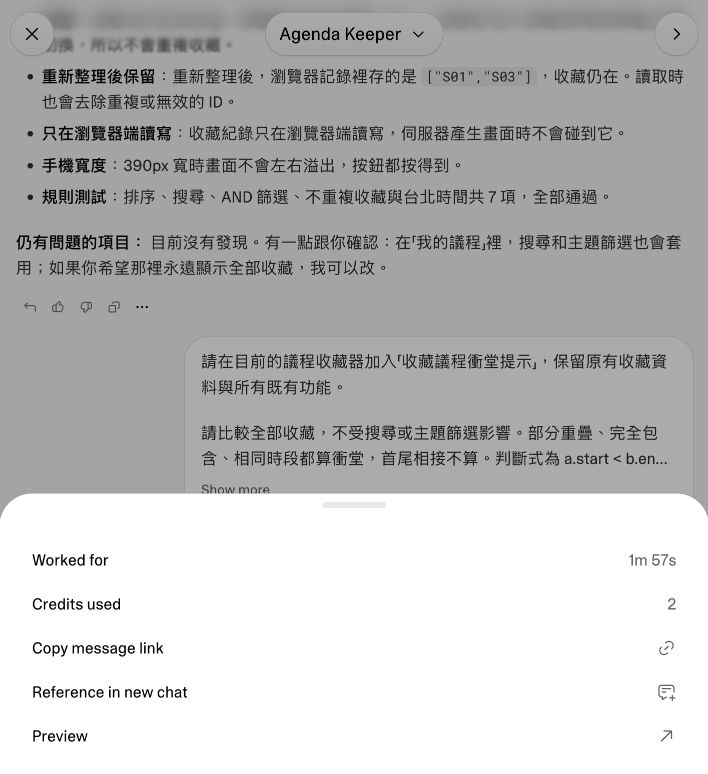
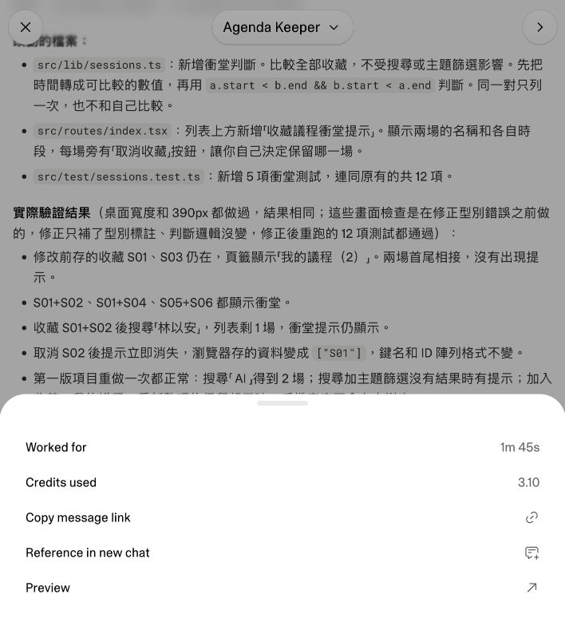

# 2026-10-13 彩排用量與費用換算

查核日期：2026-10-13。範圍為上一輪 **12 筆合成資料、較長提示**的彩排。新版 70 筆真實議程與短提示尚未獨立重測。金額均為美元，未加計稅、匯差或人的工時。

## 可核實的結果

| 階段 | Lovable 訊息實耗 | Lovable 正常月費分攤 | Codex 記錄的總 tokens | Codex Standard 情境等值 |
|---|---:|---:|---:|---:|
| 初版 | 2 credits | 約 US$0.98 | 343,319 | 約 US$0.78 |
| 衝堂修改 | 3.10 credits | 約 US$1.52 | 410,956 | 約 US$0.61 |
| 合計 | **5.10 credits** | **約 US$2.50** | **754,275** | **約 US$1.39** |

美元欄使用不同換算基礎，均不代表本次帳單實扣。Codex 速度模式未取得，US$1.39 只適用下述 Standard 假設。這份紀錄不足以判定價格勝負。

## Lovable：直接查每則訊息的 Credits used

在 Agenda Keeper 專案中，開啟兩次建置回覆的 **More options → Credits used**。初版顯示 2，衝堂修改顯示 3.10，合計 5.10 credits。這是專案訊息紀錄，沒有用整個工作區餘額的差值推算。





本次工作區為 Business、每月 1,200 credits。官方正常月繳牌價 US$588，換算為：

```text
US$588 ÷ 1,200 = US$0.49 / credit
5.10 × US$0.49 = US$2.499 ≈ US$2.50
```

這是把正常訂閱月費全部分攤到每月 1,200 credits 的假設，未把每日附送點數或其他訂閱功能分別估值。若改以 Business 加購價 US$30／50 credits 衡量，5.10 credits 的加購等值為 **US$3.06**。兩個金額是替代口徑，不相加。[訂閱牌價](https://docs.lovable.dev/introduction/subscription-plans)、[逐訊息用量與加購說明](https://docs.lovable.dev/introduction/credits-and-usage)。

帳戶當期訂閱有全額優惠，訂閱帳單顯示 **US$0**。因此 US$2.50 是未套優惠的正常月費分攤，沒有發生一筆已核實的 US$2.50 專案扣款。每則訊息使用了哪一種額度來源未取得，專案相關額外扣款也未核對。不要把優惠或講師提供群組寫成工具本身零成本。

## Codex：本機 token 紀錄的時間窗估算

本機記錄顯示工具為 Codex Desktop，CLI 版本 0.160.0，模型 `gpt-6-astra`，推理設定 `xhigh`。速度模式／service tier 未記錄，不能確認 Standard、Fast 或 Ultrafast。網頁用量頁尚未登入，依使用者要求先估算，**實際額度扣除與帳單金額未取得**。

從本機 session 的 `token_usage_record` 取每筆 `payload.usage`，只加總落在下列實作時間窗的唯一回覆，各 6 筆。沒有再加總累計欄位 `turn_token_usage`、`thread_token_usage` 或重複的 `token_count` 事件。教材只附衍生統計，不含完整對話或原始 session。

| 階段 | UTC 時間窗 | 台北時間 |
|---|---|---|
| 初版 | 03:58:54.533–04:00:49.852 | 11:58:54.533–12:00:49.852 |
| 修改 | 04:01:21.611–04:02:24.959 | 12:01:21.611–12:02:24.959 |

| token 類型 | 初版 | 修改 | 合計 |
|---|---:|---:|---:|
| 全部輸入 | 336,117 | 407,778 | **743,895** |
| 其中快取輸入 | 327,293 | 402,857 | **730,150** |
| 未快取輸入 | 8,824 | 4,921 | **13,745** |
| 輸出 | 7,202 | 3,178 | **10,380** |
| 輸入＋輸出 | 343,319 | 410,956 | **754,275** |

快取輸入包含在全部輸入內。紀錄另列的 cache write 共 13,709，包含在未快取輸入內。reasoning output 共 278，包含在輸出內。這些欄位不可重複相加。多次回覆會再次送入先前上下文，因此總 tokens 不是短提示本身的長度。

### Standard 假設與公式

[Codex 官方定價](https://learn.chatgpt.com/docs/pricing)列 GPT-6 Astra Standard 每百萬 tokens：未快取輸入 250 credits、快取輸入 25 credits、輸出 1,250 credits。Codex 不另外收取 cache write 費，這裡不套用 API 的 cache write 費率。

美元換算另採 **每 credit US$0.04 的面額假設**，依 [OpenAI 官方學生方案說明](https://developers.openai.com/community/students)中 2,500 ChatGPT credits 等值 US$100 的說明。此處只使用該面額作換算，不假設講師取得學生優惠，也不代表所有帳戶實購價格相同。

```text
Standard 額度等值
= (13,745 × 250 + 730,150 × 25 + 10,380 × 1,250) ÷ 1,000,000
= 34.665 Codex credits

美元面額等值 = 34.665 × US$0.04 = US$1.3866 ≈ US$1.39
```

Lovable credit 與 Codex credit 是不同單位，不可直接比較 5.10 與 34.665。

### 速度模式會影響估算

依 Codex 加購額度／隨用隨付的倍率，假設相同 token 數：

| 速度情境 | 相對 Standard | 美元面額等值 |
|---|---:|---:|
| Standard | 1 倍 | 約 US$1.39 |
| Fast | 2 倍 | 約 US$2.77 |
| Ultrafast | 6 倍 | 約 US$8.32 |

這是敏感度試算，不是三次實測。訂閱內含用量的倍率與上述加購費率不同，不能用此表反推訂閱剩餘百分比。訂閱登入與 API 金鑰登入的計費也不同，詳見 [官方登入與計費說明](https://learn.chatgpt.com/docs/auth)。

## 比較限制與下次紀錄方式

本次 Codex 實作沿用包含教材製作與 Lovable 操作的長對話，快取上下文消耗也算進來。兩輪操作交錯，部分回覆包含計時、驗收或切換到 Lovable 的動作。依回覆記錄時間切窗只能近似歸屬，無法精確切到每個工具動作。設定安裝與這次補查費用均不在時間窗內。

Lovable 的 5.10 credits 是兩則訊息的實耗，涵蓋平台內生成；Codex token 估算包含 Agent 協助操作與驗收的回覆。兩種邊界並不完全相同。先保留這些限制，再並列完成度、時間與資源用量，不做綜合排名。

下次以新對話、新專案進行兩套工具的同條件實測。每輪保存起訖時間、模型、速度模式、方案、完整追加提示、Lovable 每則訊息用量，以及可取得的 Codex 用量頁或帳單變動。額度來源、固定訂閱費與額外付費分開，人的主動工時與等待時間另記。專案工時成本可用「主動作業時數 × 自訂時薪」估算，這次未取得該時數，不填總成本。

對應 [原彩排時間與功能觀察](rehearsal-observations.md)、[可重算的衍生 JSON](cost-check-20261013.json)、[實測紀錄範本](../materials/measurement-template.md)。
