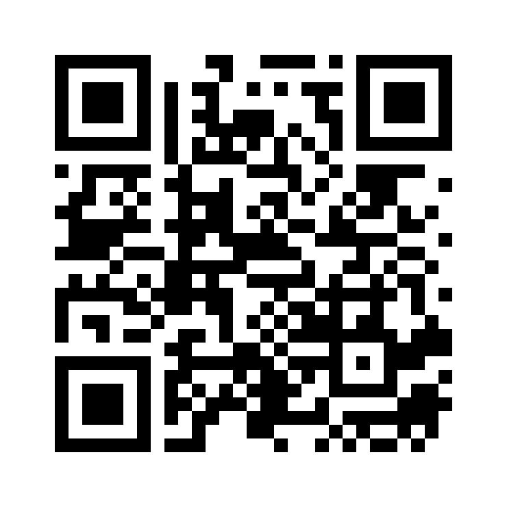

# Lovable 群組加入申請

今天的 Lovable 額度用完或不足時，可向講師申請加入本次工作坊使用的群組。

**[開啟申請表](https://forms.gle/pt3nLWy622sYTfsG6)**

https://forms.gle/pt3nLWy622sYTfsG6

只需填寫 **登入 Lovable 的 email**。送出後向講師示意，並留意信箱中的群組邀請。收到邀請後，依信件指示完成加入，再確認可繼續實作。

表單送出後由講師安排邀請，不會立即自動加入。Email 僅用於本次工作坊的群組邀請與聯繫。填寫者不需要登入 Google，其他人的申請回覆不公開。

若加入後仍無法建置，保留紀錄並使用離線參考版，繼續驗收練習。參考版入口見教材首頁。

投影片第 **3 頁**和第 **35 頁**均有 QR Code，可在需要時投影。短網址與 QR Code 指向同一份表單。

[完整填寫網址](https://docs.google.com/forms/d/e/1FAIpQLSdpGx7bm8jrByeU_m--XanCieWMK6bBI741fC-PpdKa4Id6SA/viewform)
